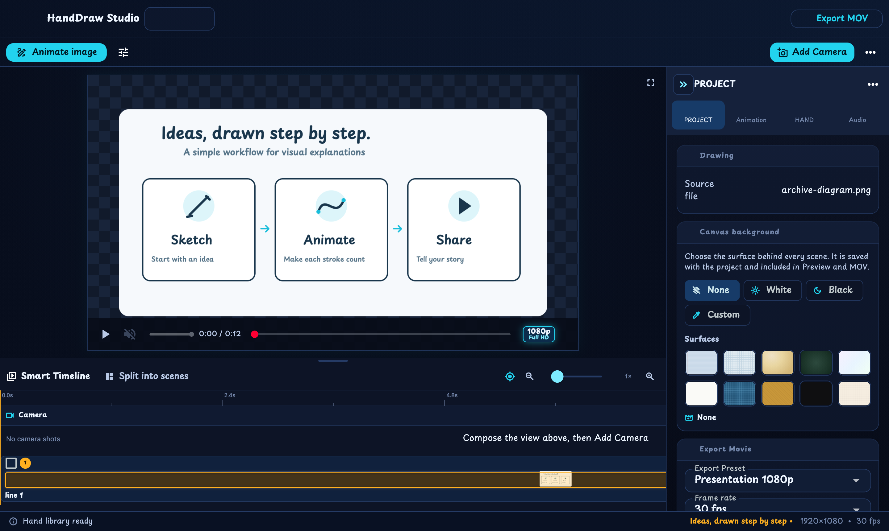
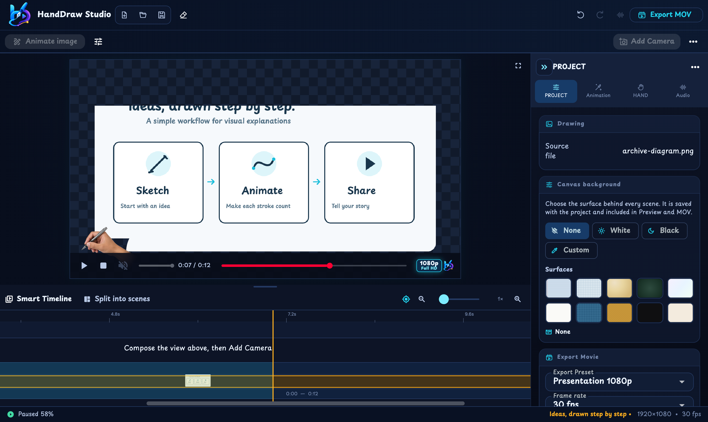

# HandDraw Studio

**A historical Flutter/macOS whiteboard-animation project.** Turn artwork into a hand-drawn sequence, edit its paths and timing, and export a transparent movie for a video editor.

This repository preserves an earlier version of the application for reference and experimentation. It is an archived project, not an actively maintained product or a promise of compatibility with future Flutter, macOS, or AI-service releases.



## What it does

- Imports raster images and SVG artwork; supported SVG geometry can be edited as paths.
- Offers automatic path generation, manual drawing paths, text reveals, and reveal/erase masks.
- Animates a calibrated hand image, with controls for the pen tip, size, rotation, and drawing order.
- Provides timeline sections, camera framing, playback controls, and undo/redo.
- Saves editable projects as `.koni` containers.
- Exports Apple ProRes 4444 `.mov` files, including transparent backgrounds, with resolution and frame-rate settings.
- Includes English and Arabic interfaces, light/dark themes, and an experimental scene composer with reusable categorized elements.



An optional Codex integration can propose drawing plans and scene designs. It requires a separately installed compatible Codex executable and account access. AI requests use that account's allowance; drawing, preview, and movie export run locally. The core editor does not require an AI account. The optional developer bridge is separate from ordinary drawing and is not required to run the editor.

## Run from source

Use macOS with Xcode and its command-line tools installed. The native target is macOS 12 or later; the maintained build path in this snapshot is macOS only. CI uses **Flutter 3.47.9**, and the package requires Dart **3.12.2 or later within Dart 3**.

From the repository root:

```sh
flutter pub get
flutter run -d macos
```

For a local Release build:

```sh
flutter build macos --release
```

The application is generated at `build/macos/Build/Products/Release/HandDraw Studio.app`. Building from source does not provide a signed or notarized distribution.

## Try the workflow

1. Import artwork using **Drawing**.
2. Generate paths automatically or draw them manually; adjust their order, masks, and timing.
3. Choose a hand and calibrate its pen tip if needed.
4. Play the preview, then refine sections and camera framing.
5. Save the `.koni` project and export a MOV.

Automatic tracing is a starting point: noisy images, small text, and overlapping content may need manual correction. SVG support covers a subset of the format; not every SVG element becomes an editable path. Scene-composer elements must not overlap in this snapshot. Export renders frames offline, so high-resolution or dense projects can take substantially longer than their playback duration.

## Development and checks

```sh
flutter analyze
flutter test
dart run tool/path_benchmark.dart
flutter test integration_test/scene_composer_test.dart -d macos
```

The regular tests exercise geometry, document operations, playback, rendering, and UI behavior. Native integration tests need a macOS desktop session. Account-backed AI tests and performance probes are separate opt-in tools; do not run them as part of an ordinary offline check.

Golden tests use a documented, bounded edge-comparison policy rather than changing the reference images. See [golden comparison](docs/testing/golden-comparison.md), [Release performance measurements](docs/testing/release-performance-results.md).

The source is organized by feature under `lib/features/`, with a local path-analysis package in `packages/handdraw_smart_path/`. Editing state uses Cubit and immutable document models; preview and export share drawing geometry and timing services.

## Attribution and bundled assets

The project is released under the [MIT License](LICENSE). The owner has confirmed the rights to redistribute the bundled media; see [Asset Licenses](ASSET_LICENSES.md) for their scope and provenance. Third-party components retain their own licenses and notices: [Third-Party Notices](THIRD_PARTY_NOTICES.md), [Playpen Sans font license](assets/fonts/playpen_sans_arabic/OFL.txt), and [recorded-sound provenance notes](assets/sounds/README.md). Third-party trademarks remain the property of their respective owners.

## بالعربي

**HandDraw Studio** مشروع قديم لتطبيق macOS مبني بـFlutter، محفوظ هنا كأرشيف للرجوع إليه والتجربة، وليس منتجًا قيد التطوير المستمر.

تقدر تستورد رسمة، تولّد مساراتها أو ترسمها يدويًا، تضبط حركة اليد وترتيب الأجزاء والتوقيت والكاميرا، ثم تحفظ المشروع بصيغة `.koni` وتصدّر فيديو MOV بشفافية. الواجهة تدعم العربية والإنجليزية، والرسم والمعاينة والتصدير يعملون محليًا.

تكامل Codex اختياري ويحتاج تثبيتًا وحسابًا متوافقين؛ طلبات الذكاء الاصطناعي تستهلك من استخدام الحساب. لتشغيل التطبيق من السورس، اتبع أوامر التشغيل أعلاه على macOS. جودة تتبّع الصور تعتمد على المصدر وقد تحتاج تعديلًا يدويًا، خصوصًا للنصوص الصغيرة والصور المزدحمة.
